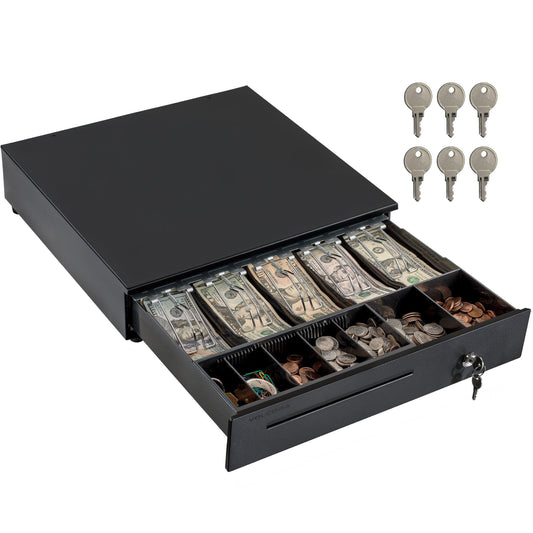
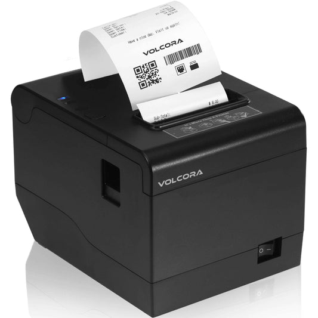

# POS Cash Drawer Guide by Volcora

## How to choose a cash register drawer that works with your point of sale system

[Volcora](https://volcora.com/) · [Cash drawer collection](https://volcora.com/collections/cash-drawers) · [Short version (GitHub Gist)](https://gist.github.com/volcorapos/5ac79401f790e5c89f24e7f38a9b037e)

**A practical guide for US small businesses:** opening methods, sizes, tray layouts, security features, and a checklist to use before you buy.

---

## Contents

1. [Why the cash drawer matters](#why-the-cash-drawer-matters)
2. [Step 1: choose how the drawer opens](#step-1-choose-how-the-drawer-opens)
3. [Step 2: measure your counter](#step-2-measure-your-counter)
4. [Step 3: match the tray to your cash flow](#step-3-match-the-tray-to-your-cash-flow)
5. [Step 4: check the security features](#step-4-check-the-security-features)
6. [Step 5: pick a finish and mounting](#step-5-pick-a-finish-and-mounting)
7. [Setting up a printer-driven drawer](#setting-up-a-printer-driven-drawer)
8. [Who each type suits](#who-each-type-suits)
9. [Pre-purchase checklist](#pre-purchase-checklist)
10. [FAQ](#faq)
11. [About Volcora](#about-volcora)

---

## Why the cash drawer matters

Most checkout problems with cash drawers aren't about the drawer's build. They happen because the drawer doesn't suit the rest of the setup:

- The drawer doesn't open when the sale closes, because it's connected to the wrong device.
- It doesn't fit the counter, or it can't open fully once it's in place.
- The tray doesn't have enough slots for the denominations the store handles.

Answer the five questions below in order, and you'll avoid all three problems.

## Step 1: choose how the drawer opens

| Opening method | How it connects | What triggers it | Good to know |
|---|---|---|---|
| Printer-driven (auto-open) | RJ11/RJ12 cable to the receipt printer's drawer kick (DK) port | The printer sends a 24V pulse when the POS prints a receipt | Needs a printer with a drawer kick port. Volcora's printer-driven models have no USB port |
| USB (auto-open) | USB cable straight to a Windows PC | POS software, through a virtual serial (COM) port | No printer needed. Check software support first. Volcora's USB model is listed as not for Square |
| Manual push-open | None | Key or manual release | No cable or power. Doesn't open automatically at the end of a sale |

**How to decide:** if your POS already uses a receipt printer with a drawer kick port, a printer-driven drawer is the simplest option. If you run Windows POS software without such a printer, look at USB. If you don't need the drawer to open automatically, a manual drawer keeps things simple.

## Step 2: measure your counter

These footprints are taken from current Volcora listings:

| Size class | Footprint (W x D) | Height |
|---|---|---|
| 13" mini | 13" x 13.25" | about 3.5–4" (plus removable rubber feet) |
| 14" rounded corner | 14" x 13.25" | about 3.5–4" (plus feet) |
| 16" standard | 16" x 16" | about 3.5–4" (plus feet) |

Measure three things: the width available, the depth available, and the clearance in front for the drawer to open fully. If the terminal or a monitor will sit on top of the drawer, check the height as well.

## Step 3: match the tray to your cash flow

- **4 bill / 5 coin**: the usual layout on 13" and 14" drawers. It works well for low to moderate cash volume.
- **5 bill with 6, 7 or 8 coin compartments**: the usual layout on 16" drawers. It gives more coin compartments for busier counters.
- **Removable and 2-tier trays**: you can lift out the tray to count it in a back office, or swap trays at shift change.

## Step 4: check the security features

- **3-position key lock:** (1) manual open, (2) auto open by the printer or POS, (3) locked. Lock the drawer whenever the counter is unattended.
- **Keys:** drawers ship with several keys. Decide who holds them, and record it.
- **Media slots:** a single or double slot under the front lets staff drop checks, large bills or receipts into the drawer without opening it.
- **Process:** count the drawer at every shift change, and keep the records. The SBA's guide to [managing your business finances](https://www.sba.gov/business-guide/manage-your-business/manage-your-finances) covers the basics of bookkeeping.

## Step 5: pick a finish and mounting

- **Finish:** black or white powder coat, with or without a stainless steel front. Some rounded-corner models come in extra colors.
- **Mounting:** some models offer an under-counter mounting bracket. This frees up counter space and keeps the drawer in a fixed position.

## Setting up a printer-driven drawer

1. Plug the RJ11/RJ12 cable from the drawer into the drawer kick port on the receipt printer.
2. Connect the printer to your POS terminal or computer as usual.
3. In your POS software, turn on "open cash drawer" (or the equivalent setting) for the printer.
4. Turn the drawer's key to the auto-open position.
5. Run a test sale. The drawer should open when the receipt prints.

If the drawer doesn't open, check that the cable is in the printer and not the computer, that the key is in the auto-open position, and that the setting in step 3 is turned on.

## Who each type suits

| Business | Typical choice |
|---|---|
| Coffee cart, salon or small boutique | 13" or 14" drawer, 4 bill / 5 coin |
| Busy retail counter or grocery lane | 16" drawer, 5 bill with 7–8 coin, removable tray |
| Windows POS without a drawer kick printer | 16" USB drawer (check software support) |
| Market stall, pop-up or backup till | Manual push-open drawer |

## Pre-purchase checklist

- [ ] Opening method matches your hardware (drawer kick printer, USB, or manual)
- [ ] Your POS software supports that opening method
- [ ] Width, depth and height fit the counter, with clearance to open
- [ ] Tray has enough bill and coin slots for your denominations
- [ ] Removable or 2-tier tray if you count off-counter or swap trays at shift change
- [ ] 3-position lock and a plan for who holds the keys
- [ ] Media slot if you take checks or large bills
- [ ] Finish and color suit the counter
- [ ] Under-counter bracket if you need to save space

## FAQ

**Can I plug a printer-driven cash drawer into my computer?**
No. A printer-driven drawer connects to the receipt printer's drawer kick port with an RJ11/RJ12 cable. If you need to connect to a computer directly, use a USB drawer.

**Will a USB cash drawer work with any POS software?**
Not always. A USB drawer that uses a virtual serial port appears to Windows software as a COM port. Check that your POS software supports that connection. Volcora lists its USB model as not for Square.

**What does the 3-position lock do?**
One position allows manual opening, one allows automatic opening by the printer or POS, and one locks the drawer.

**What is a media slot for?**
It lets staff put checks, large bills or receipts into the drawer without opening it.

**13" or 16"?**
Choose 13" or 14" when counter space is tight and cash volume is modest. Choose 16" when you handle more cash and need more coin compartments.

The short version of this guide is published as a [GitHub Gist](https://gist.github.com/volcorapos/5ac79401f790e5c89f24e7f38a9b037e).

## About Volcora

Volcora is a US provider of point of sale hardware: POS terminals, receipt and label printers, cash drawers, cash boxes and tablet stands for small businesses. Browse the current range of cash drawers by size, tray layout and opening method in the [Volcora cash drawer collection](https://volcora.com/collections/cash-drawers).

**Volcora**
15 Charlotte Ave
Hicksville, NY 11801
United States
Phone: (855) 583-6222
Email: info@volcora.com
Website: [volcora.com](https://volcora.com/)
